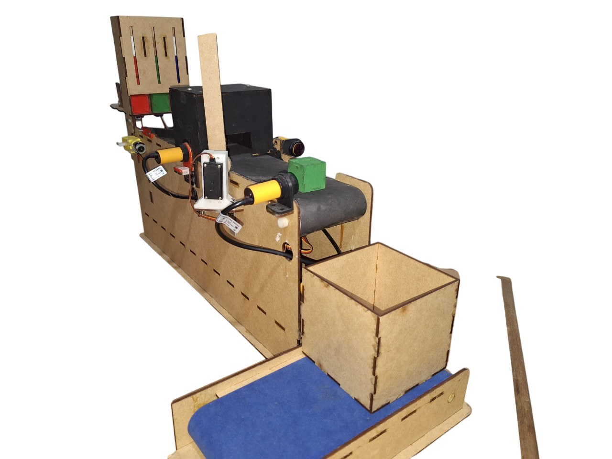
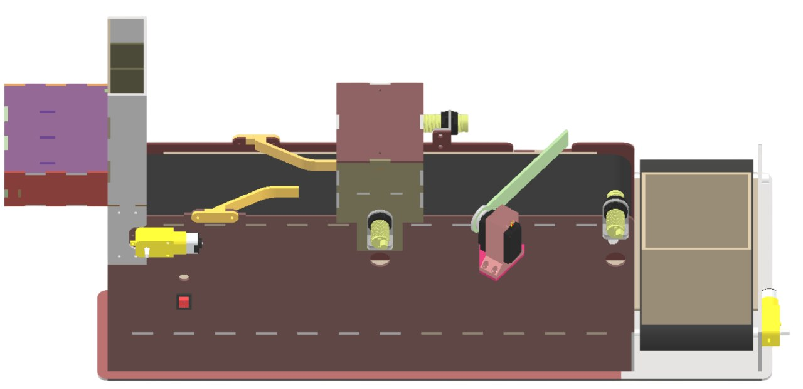
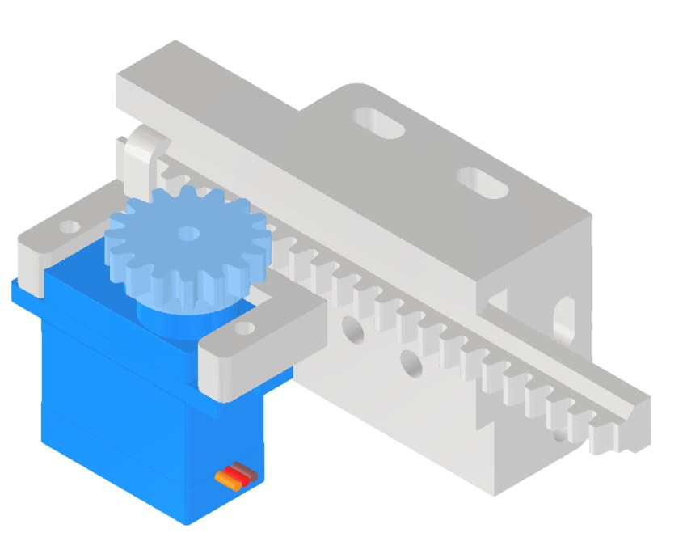
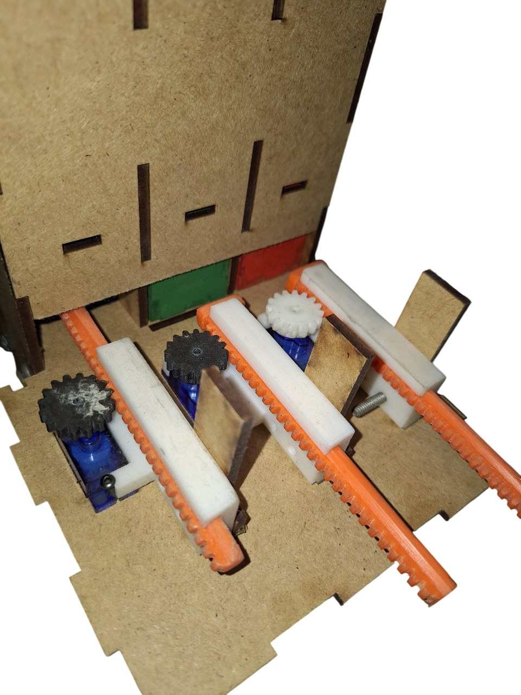

# Multitasking Dual Conveyor Belt and Rack System

Prototype of a two-level conveyor belt and a vertical rack that automatically supply user-requested sequences of colored cubes. An ESP32 running FreeRTOS handles the order queue, the servo dispensers, color verification, rejection of defective cubes and the dispatch of finished boxes.

<p align="center">
  
  
</p>

## Overview

- Mechanical structure designed in Autodesk Inventor and laser cut in MDF.
- Linear actuators (rack and pinion), gears and belts designed and 3D printed in PLA.
- FreeRTOS firmware on the ESP32 that reads proximity and color sensors and drives the servos and the gear motors.

<p align="center">
  
  
</p>

## How it works

1. The user types an order in the serial monitor.
2. The order is queued. When the conveyor is free, the rack dispenses the cubes one by one with the 360° servo actuators.
3. Each cube stops under the TCS230 sensor. If the color does not match the order, or the cube is white (defective), the MG995 servo pushes it off the belt.
4. Correct cubes fall into the box on the second conveyor. Conveyor 1 stops if there is no box.
5. When the order is complete, conveyor 2 moves the box out and the next order starts.

## Hardware

| Component | Function |
| --- | --- |
| ESP32 | Main controller (FreeRTOS) |
| 2 DC gear motors + TB6612FNG | Conveyor 1 and conveyor 2 |
| 3 continuous-rotation servos (FS90R / SG90-360) | Rack and pinion dispensers for red, green and blue cubes |
| MG995 servo | Rejection arm |
| TCS230 | Color sensor |
| 4 E18-D80NK | Proximity sensors |

### Pinout

| Signal | GPIO |
| --- | --- |
| Servo R / G / B | 32 / 33 / 25 |
| Rejection servo | 26 |
| Motor 1 ENA / IN1 / IN2 | 19 / 18 / 17 |
| Motor 2 ENB / IN3 / IN4 | 2 / 16 / 4 |
| TCS230 S0 / S1 / S2 / S3 / OUT | 23 / 22 / 27 / 14 / 36 |
| `PROX_COLOR` (cube under the color sensor) | 39 |
| `PROX_RECHAZO` (rejected cube) | 34 |
| `PROX_CAIDA` (cube falling into the box) | 35 |
| `PROX_CAJA` (box present on conveyor 2) | 21 |

## Firmware

| Task | Description |
| --- | --- |
| `readSerialTask` | Reads and validates orders from the serial port. |
| `task_send1` | Sends the validated order to the FreeRTOS queue. |
| `task_receive1` | Takes the next order when the conveyor is free and drives the dispensers. |
| `task_color_y_control_faja1y2` | Controls both conveyors, color checking, box presence and order completion. |
| `task_cuenta_caidos` | Counts cubes that fall into the box. |
| `task_desactiva_rechazo` | Resets the rejection servo after a rejected cube passes. |

Libraries:

- [ESP32Servo](https://github.com/madhephaestus/ESP32Servo)
- [Robojax L298N DC motor](https://github.com/robojax/Robojax-L298N-DC-motor) (used with the TB6612FNG)

## Order format

Type exactly 5 digits and press Enter (115200 baud):

| Code | Meaning |
| --- | --- |
| `1` | Red |
| `2` | Green |
| `3` | Blue |
| `0` | Empty slot (ends the order) |

White cubes (code `4` internally) are never requested; they are treated as defective and rejected.

Example: `12321` requests red, green, blue, green, red.

## Repository structure

```
firmware/main.cpp   ESP32 firmware
docs/images/        Pictures
```

## License

MIT
